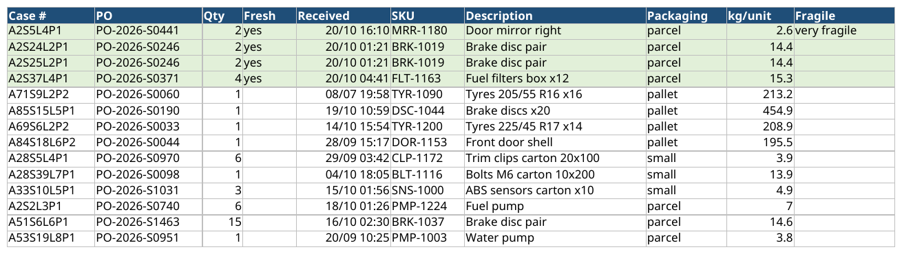
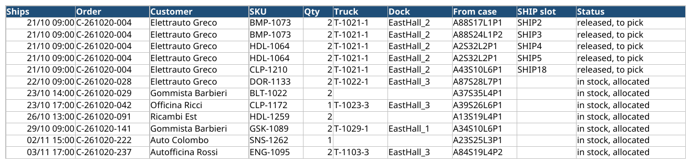
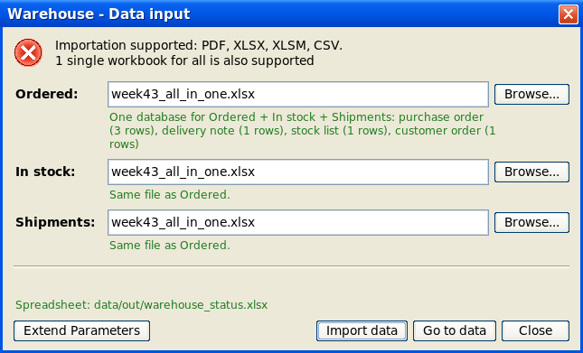
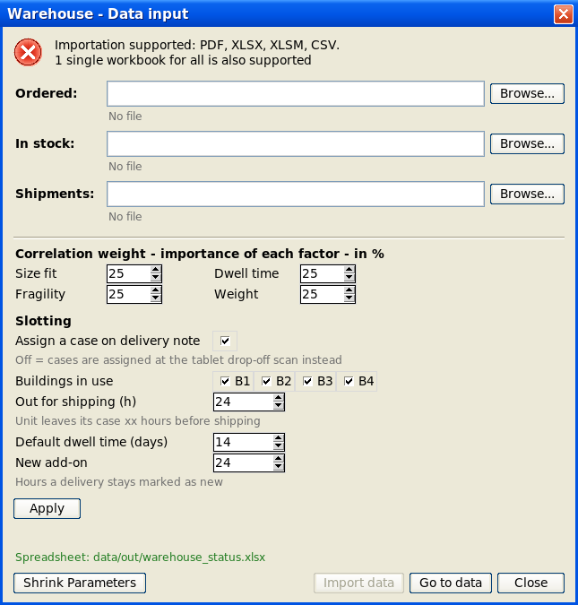
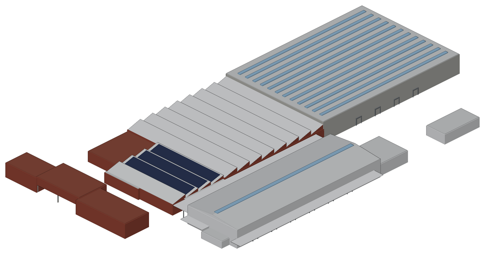
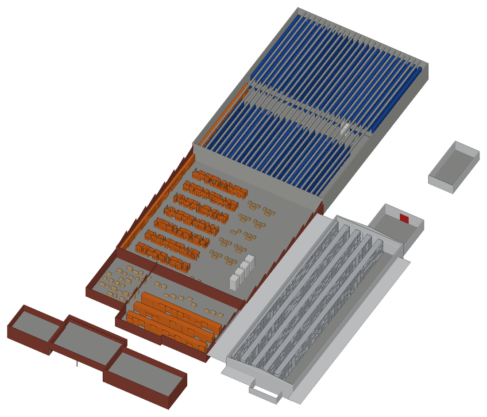

# Smart Slotting

**Every delivery gets the right shelf before the forklift moves.**

Drop in your purchase orders, delivery notes and customer orders. The system books the best storage case for each pallet, parcel and carton, and keeps one live spreadsheet that the whole team can read.

- **Case number on arrival.** A delivery note comes in, and every unit already has its case: `A67S3L1P2`.
- **More goods in the same space.** In our demo, bins and shelving went from almost empty to 79% full. Tall slots are kept for tall pallets, so nothing gets left out.
- **Ready for the truck.** 24 h before departure, units are released from their case and given a slot in the shipping area.
- **No new tool to learn.** It reads your Excel and PDF files as they are, in English, French or Italian.

---

## Your daily view: one spreadsheet, always up to date

`data/out/warehouse_status.xlsx` refreshes by itself after every change.

**In stock**: where everything is. Fresh arrivals are highlighted.



**Shipments**: what leaves, when, from which case, on which truck.



Also in the file:
- **Ordered**: what's still expected from suppliers
- **In stock**: the full-detail version of the view above

---

## One window to feed it

Open the spreadsheet and the input window opens with it. Pick your files and click **Import data**.



- PDF, XLSX, XLSM or CSV.
- One workbook holding orders, stock and shipments together is recognised and imported once.
- Column titles don't need to match a template: `PO`, `Purchase order`, `N° commande`, `Ordine fornitore`… Units are converted too (cm, g, …).
- Rows with a problem are listed, with the row number and the reason. Everything else goes in.

**Extend Parameters** lets you tune the system without a technician:



---

## How a case is chosen

1. **Only cases that fit.** Size, height, weight per shelf, and packaging type (pallet rack, shelving or bin).
2. **Then the best one**, scored on four factors you weight yourself:
   - **Size fit**: no wasted space, and tall slots kept for tall goods
   - **Dwell time**: fast movers near the docks, low down
   - **Fragility**: fragile goods low
   - **Weight**: heavy goods low
3. **Nothing fits?** The unit is marked `EXTRA` for the manager to decide.

---

## Built on your real warehouse

All four buildings were modelled in 3D (FreeCAD) from site photos, cadastre data and video. Every rack, bay and level got a permanent number.

| The site | Inside: every rack, bay and level |
|---|---|
|  |  |

**18,707 storage cases:**
- 2,990 pallet positions
- 9,130 shelving cases
- 6,552 small-parts bins
- 35 floor spots
- plus a 40-slot shipping area

*Rack sizes are estimates. An on-site check is planned before go-live.*

---

## Get started

```bash
python3 -m venv .venv && .venv/bin/pip install -r engine/requirements.txt -r watcher/requirements.txt
```
```bash
scripts/dev.sh
```

Then open `data/out/warehouse_status.xlsx`.

To try it with a warehouse about 70% full:

```bash
.venv/bin/python data/samples/seed_full_warehouse.py
```

---

For the technical team:
- `CLAUDE.md`: architecture, rules, commands
- `docs/PRD.md`: decisions
- `docs/matrix_weights.md`: the scoring in detail
- `docs/img/make_screenshots.py`: rebuilds these images
